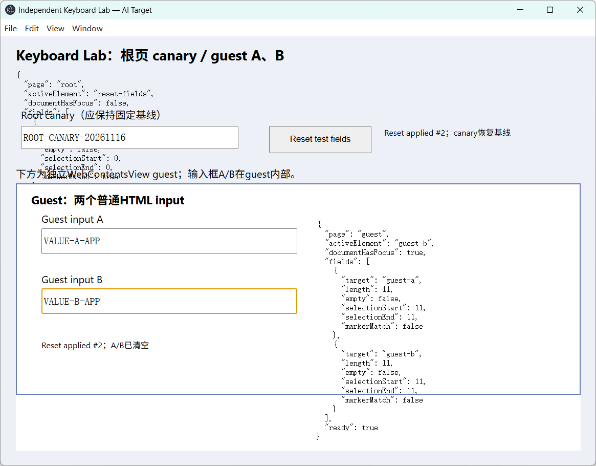

# Verification and limits

## Reproduce without desktop input

Windows 10/11, Windows PowerShell 5.1 and Node.js 24 (the SQLite tests use built-in node:sqlite):

```powershell
cd integrations/codex
npm test
```

No npm install is needed. The explicit allowlist is `scripts/verify.mjs`: compact observation/control projections; root sidebar/project identity against temporary SQLite/WAL fixtures; focus policy; cancellation/timeout/EOF with thin transport recorders; fresh Value setter with simulated providers; compiled keyboard/stop/placement methods; actual independent-process Windows mutex/guardian FIFO, cancellation, pause, PID-birth and ready wakeups. Tests use temporary data roots and random internal TestNamespace values. They do not send mouse/keyboard input, show overlay/fixture windows, install a plugin or clear real desktop ownership/pause. CI runs this allowlist on windows-latest; CI is not GUI acceptance.

Expected: every listed process exits 0 with PASS/GREEN. Provider/transport tests are synthetic contracts; actual subprocess/mutex tests exercise the shared Windows control protocol, not an application. The wakeup test creates a copied guardian with a post-release teardown barrier, proving that a still-alive exiting guardian does not delay readiness to the full wait deadline. No production sleeps are added.

The asset test resolves both repository and standalone paths, decodes the original upstream 512x192 atlases, and compiles pure overlay placement methods without Show. It requires no personal cursor metadata. Root DSH entry files and assets are compared byte-for-byte to the upstream baseline during preparation; that is a regression boundary, not an actual DSH Host run.

## Native capture build (manual prerequisite, no screenshot)

```powershell
cmd /c native\window-capture\build.cmd
native\window-capture\bin\win-x64\dsh-window-capture.exe --probe
```

Requires existing Visual Studio C++ tools and Windows SDK. `--probe` checks capabilities only: no capture/foreground/input. Binaries are generated locally and ignored in Git. WGC capture itself needs an explicitly authorized GUI test and is not run by npm test/CI. Standard system capture borders are not disabled.

## Previously obtained live evidence (redacted)

On Windows with Node 24 and Codex Desktop, the local 0.6.0 runtime reported control protocol 2. With a real holder and two real queued executions, normal finish woke the first waiter; a fresh begin obtained a new lease; only that hold's first eligible tool reply contained the queue reminder. Two following status replies contained no duplicate. After finish the second pending waiter became ready and cancelled its own ticket without application input. Tool delivery does not prove that a model read a reminder.

The same authorized executor used fresh observed elements in an owned Electron WebContentsView fixture. Four explicit mode:value writes (replace/append for two fields) returned exact value-readback-only verification; final visual inspection showed the expected values and an unchanged root canary. Fixture logs showed input and DOM focus events. Those results cover that fixture only, not all frameworks, IME or arbitrary applications. This evidence predates this source-only layout and the upstream-asset fallback; it is not claimed as a new GUI run of this PR checkout. Only the owned fixture screenshot below is published; no private desktop, transcript, conversation ID, project name, profile or raw log is published.

System foreground was sampled only before/after; no continuous recorder ran in that final round. Unchanged human text does not prove foreground preservation. Game focus, arbitrary-app focus preservation, a specific business app's new Value path, and native DSH Host behavior remain unverified. No claim of full native-input equivalence is made. The final live executor finished normally and released its own lease. Codex was not closed or restarted.

## Relationship to existing upstream work

Open PRs #3 and #4 address the original DSH tool-schema contract; #4 also improves text handling. This PR does not incorporate their unmerged changes or claim those fixes exclusively. Its Codex adapter exports a standard MCP object schema while leaving the DSH entry unchanged. A future shared-core extraction needs a separately verified DSH identity/lifecycle contract.


### Owned fixture visual evidence



The authorized capture shows only the owned fixture and public test markers. A and B display `VALUE-A-APP` / `VALUE-B-APP`, while the root canary remains unchanged. The fixture's generic markerMatch flags refer to its separate original test-marker configuration and are not the Value readback verifier. This image proves neither focus preservation nor every framework's state/event handling.

### Selected live queue fields (redacted projection)

These are selected non-identity fields from three preserved formal MCP replies, not complete raw responses. IDs, names, projects and leases are omitted. The parent's earlier observation summary placed its ticket at position 2 behind sequence 1; that first-position statement is a summary, not an archived raw body.

```json
{
  "waiting": {"ok":true,"state":"busy","turn":"queued","position":1,"canAcquire":false,"waitResult":"timeout","reminderStatus":"delivered-to-tool","queue":[{"position":1,"sequence":2}]},
  "ready": {"ok":true,"state":"available","turn":"ready","position":1,"canAcquire":true,"waitResult":"ready","queue":[{"position":1,"sequence":2}]},
  "cancelled": {"ok":true,"state":"available","turn":"not-queued","position":0,"canAcquire":true,"queue":[]}
}
```

The single-holder reminder/no-repeat behavior was reported by the actual executor (two later status responses); no preserved full raw body is claimed for those two reports. `delivered-to-tool` is delivery metadata, not proof of model attention. No direct message was sent to the other holder.
